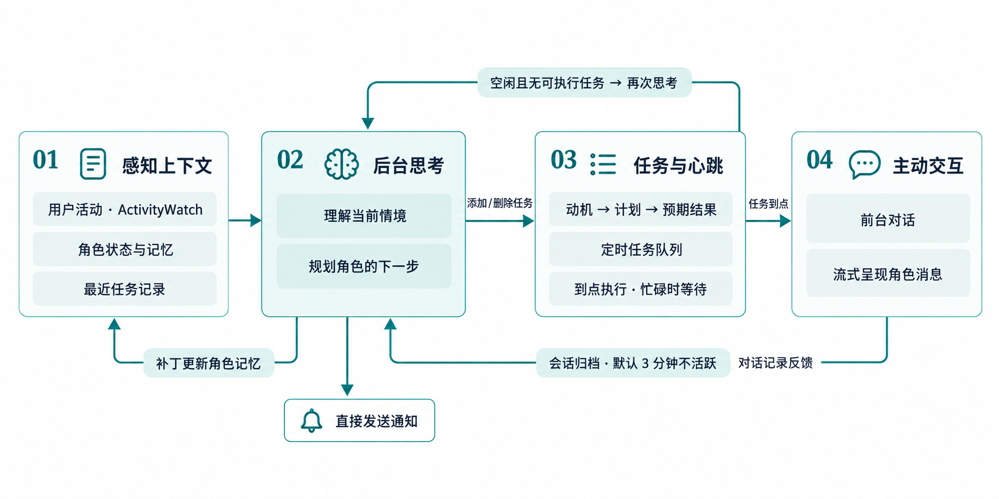

# 运行

目前只适配了macOS。

1. 安装[ActivityWatch](https://github.com/ActivityWatch/activitywatch/releases/tag/v0.13.2)

2. 确保有cargo和pnpm。然后：
```zsh
pnpm install
pnpm tauri dev
```

之后在 设置-ai设置中填写apikey，然后在 设置-调度 中启动心跳。

# 主动性机制（Proactivity）概览



> 目标：解释项目里“角色如何主动行动 / 主动发起对话 / 主动更新自身记忆”的整条链路。本文从入口、数据结构、心跳调度、AI 推理调用、工具（tools）赋能与记忆更新六个方面，结合实际代码片段与示例说明。

---
## 1. 总体心智模型
可以把系统想象成一个“有内部时钟的剧本编排器”：
- 一个心跳循环（schedule heartbeat）定期检查是否有需要执行的任务，或系统是否空闲；
- 若有到点的任务，就触发一段前台对话（让角色说话 / 行动）；
- 若任务列表为空且系统空闲，会触发一次“后台思考”会话，让 AI 读取最近用户事件（ActivityWatch）+ 角色状态 + 历史任务，进而：
  - 生成/调整未来的任务（addSchedule / deleteSchedule）；
  - 更新角色记忆（applyPatchToCharacterState / applyPatchToHistoryTasks）；
  - 发送通知（addNotificationTool）。

于是：前台会话偏“即时呈现”角色的行为；后台会话偏“自我反思 + 规划 + 记忆演化”。

---
## 2. 关键数据存储
### 2.1 角色记忆（`useMemoryStore`）
字段：
- `characterState`：Markdown 文本，含“角色背景 / 用户画像推测 / 历史交互事件”等板块。
- `historyTasks`：任务历史记录文本。
- `lastActivityQueryAt`：上次抓取用户事件（ActivityWatch）的时间戳，用于增量查询。

两类核心“Patch”应用方法：
- `applyPatchToCharacterState(patch)`
- `applyPatchToHistoryTasks(patch)`

它们使用一个定制的迷你 diff 语法（`*** Begin Patch ... @@ Header ... -旧 +新 ... *** End Patch`）定位并修改 Markdown。AI 通过 tool 产出补丁，从而安全地、增量更新文本，而不是整篇覆盖（降低“遗忘”风险）。

### 2.2 调度任务（`useScheduleStore`）
任务结构 `ScheduleTask`：
- `content`：`{ title, motivation, plan, expectedOutcome }` 四段式，强调“行动动机→计划→期望结果”；
- 时间戳：`scheduledAt`（计划执行时刻）、`outdatedAt`（过期时刻，可选）、`createdAt / startedAt / finishedAt`；
- 状态：`scheduled | pending | running | outdated | accomplished | canceled`；
- 结果：`{ type: executed | outdated | canceled, error? }`。

心跳间隔默认 60s，可调节；每次心跳推进状态并挑选一个任务串行执行（严格避免并发）。

### 2.3 会话分层（`useSessionStore`）
- `currentSession`：当前前台或调度触发的对话消息。
- `historySessions`：被“非活跃超时”切割下来的历史前台对话。
- `backendSessions`：后台（主动规划、记忆更新）会话存档；便于分析 AI 的“自我反思轨迹”。

切割机制：若一段时间（默认 3 分钟）没有新消息，会自动归档并清空 `currentSession`。归档时还会触发一次 `backendChat`，让后台思考接续最新用户行为（见后文“触发点汇总”）。

---
## 3. 心跳（Heartbeat）与任务执行流程
启动入口：`MainPage.vue` 的 `onMounted` 中：
```ts
const schedule = useScheduleStore()
schedule.rehydrate()
schedule.startHeartbeat()
```

核心流程（简化伪代码）：
```ts
_heartbeatSafe() {
  if (HeartbeatOn) _heartbeat();
  setTimeout(_heartbeatSafe, heartbeatIntervalMs);
}

_heartbeat() {
  now = Date.now();
  // 1. 推进状态 scheduled->pending, scheduled/pending 过期->outdated
  advanceStates();

  // 2. 若系统完全空闲（无 scheduled/pending/outdated），发射空闲事件 & 触发后台会话
  if (!hasFutureTasks) backendChat(getBackendEventsUserPrompt());

  // 3. 如果当前有会话在进行（聊天流/Session 正活跃）或 store 标记 busy，就跳过
  if (isBusy || chatBusy || activeUserSession) return;

  // 4. 选任务：优先 outdated，再按时间最早 pending
  candidate = pickOne();
  if (!candidate) { backendChat(getBackendEventsUserPrompt()); return; }

  // 5. 执行：置 running → 调用 onTask / onOutdated → 完成后置 accomplished
}
```

执行 `onTask(content)` 后会调用 `scheduleStartChat(content)`，启动一个“前台流式对话”，渲染成用户可见的角色行为。

示例：
1. 后台规划阶段生成任务：“5 分钟后提醒用户喝水”。
2. 5 分钟后心跳检测到 `scheduledAt <= now` → 状态 `scheduled -> pending -> running`。
3. 触发 `onTask`，模型收到系统 prompt + 任务内容，生成多条 `<item>` 对话（如：“主人，记得喝水哦～”）。
4. 流式解析 `<item>` 推送到 UI。

若任务过期（例如用户长时间离开），状态流：`scheduled -> outdated -> running` → 调用 `onOutdated`（目前是 stub，可扩展为“补记历史”或“改写计划”）。

---
## 4. 前台 vs 后台 AI 会话对比
| 维度 | 前台（scheduleStartChat / userStartChat） | 后台（backendChat） |
| ---- | ---------------------------------------- | -------------------- |
| 触发 | 用户输入 / 任务到点 | 心跳空闲 / 会话归档 / 主动拉取事件 |
| Prompt 组成 | 前端角色提示（含角色状态）+ 用户输入 或 任务描述 | System + 角色状态 + 历史任务 + 最近活动事件 + 终指令 |
| 工具权限 | addNotification / addSchedule / deleteSchedule | 同上 + applyPatchToCharacterState / applyPatchToHistoryTasks |
| 目标 | 生成即时对话/行动反馈 | 规划未来、更新记忆、产生结构化任务 |
| 输出存档 | 写入 currentSession（后续可能归档） | 进入 backendSessions |

注意：后台会话是“自触发式自监督循环”的关键，它给 AI 一个机会在没有即时用户输入的时段继续演化角色。

---
## 5. 工具（Tools）如何赋能“主动性”
### 5.1 任务类
- `addSchedule(delaySeconds, outdatedSeconds, content)`：创建一个未来动作计划。
- `deleteSchedule(id)`：删除不再需要的计划（避免僵尸任务）。

### 5.2 记忆类
- `applyPatchToCharacterState(patch)`：在 `characterState` 上套用差异补丁，增量维护角色背景 / 用户画像 / 交互事件。
- `applyPatchToHistoryTasks(patch)`：对历史任务文本进行提炼、归纳简化。可减少“提示膨胀”。

### 5.3 交互 / 环境类
- `addNotificationTool`（未在本篇详述）可向用户发本地提醒。
- ActivityWatch 抓取最近事件，通过 `getBackendEventsUserPrompt()` 注入后台会话，构成“感知输入”。

组合示例（可能的后台产出）：
```
1) 观察：最近 30 分钟频繁切换 VSCode 与 浏览器 → 推测用户在查文档。
2) Patch：在“用户画像推测”添加 “用户当前在进行开发调研”。
3) 添加任务：15 分钟后 主动询问进展。
4) 发送通知：鼓励用户短暂休息。
```

---
## 6. Patch 应用机制细节（记忆的安全演化）
`memory.ts` 中的 `applyPatch`：
- 解析 `*** Begin Patch ... @@ header` 分块；
- 每块由行前缀区分：`' '`（上下文）、`'-'`（删除）、`'+'`（新增）；
- 按 header 锚定文档区段（Markdown 的 `#` 开头行作为分节界标）；
- 优先尝试 exact 匹配 expected（上下文+删除行形成的序列）→ 直接替换为 replacement（上下文+新增）；
- 不成功则用纯上下文匹配插入；再失败则 fallback：追加到 header 段末尾或文档末尾。
- 如果包含删除语义且无法匹配，会抛错（防止误删）。

好处：
- AI 只需生成最小变更；
- 冲突→抛错，避免“走样”；
- 支持多块修改，且严格区分全/半角字符，减少中文环境 diff 混淆。

简单例子（增加一条用户兴趣）：
```
*** Begin Patch
@@ #### 用户画像推测
 用户特征
-空，还没有产生过推测。
+喜欢二次元与技术折腾。
*** End Patch
```

---
## 7. 用户事件（ActivityWatch）如何进入后台推理
调用链：
```
heartbeat 空闲 → backendChat(getBackendEventsUserPrompt())
  → getBackendEventsUserPrompt()
      lastActivityQueryAt 读取并计算 delta
      getRecentEventsFromAllBucketsInString(pastMs)
        listBuckets() / getRecentEvents() （Tauri HTTP）
      返回最近事件 JSON（按 bucket 切片，截断长度）
  → 作为一条 user 消息注入模型
```
`lastActivityQueryAt` 会更新，保证下次只抓取“增量时间窗”，减少重复。

---
## 8. 触发点汇总（什么时候会“主动”）
| 触发类型 | 条件 | 行为 |
| -------- | ---- | ---- |
| 心跳任务执行 | `scheduledAt <= now` | 前台对话（onTask → scheduleStartChat） |
| 任务过期 | `outdatedAt <= now` | `onOutdated`（可扩展补救/总结） |
| 心跳空闲规划 | 无可执行/待执行任务 且 会话空闲 | 后台会话（backendChat）生成新计划或补丁 |
| 会话超时归档 | `inactivityTimeoutMs` 到期 | 归档当前会话 + 后台会话（backendChat）复盘最近消息 |
| 用户手动输入 | 用户发送消息 | 前台流式对话（userStartChat） |

这些触发共同构成“被动-主动”闭环：
用户行为/时间流逝 → 事件采集 / 定时任务 → 空闲检测 → 后台规划 → 产生新任务 / 更新记忆 → 下次心跳执行 → 用户又收到角色主动输出。

---
## 9. 可扩展点与改进建议
1. `onOutdated` 目前为空，可实现：
   - 记录“错过的行动”到记忆；
   - 重新排期（自动 addSchedule）。
2. 任务优先级：可加入 `priority` 字段 + 更智能的选择策略（例如基于动机类别）。
3. 并发保护：当前使用 `isBusy` + 流状态判断，未来可引入一个“全局执行锁”对象，减少逻辑分散。
4. 记忆卷积：定期对 `historyTasks` 做自动摘要（工具 already 存在但策略未写）。
5. 事件过滤：ActivityWatch 可能产生高噪声，可加白名单/分类聚合，以便 AI 简洁理解。
6. 评估环：为每个任务执行后自动写回“结果/反思” Patch，推动角色更拟人化。

---
## 10. TL;DR（一句话总结）
系统通过“心跳 + 任务调度 + 后台自监督会话 + Patch 式记忆更新”形成一个能在用户空闲时自我规划、在合适时间点主动输出的虚拟角色循环。

---
（完）
